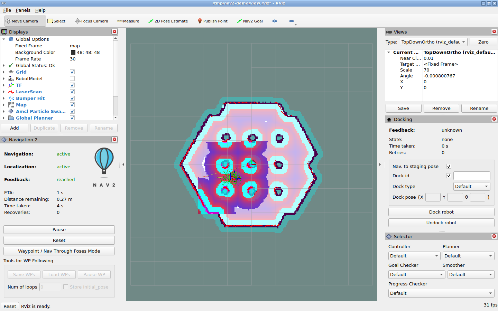
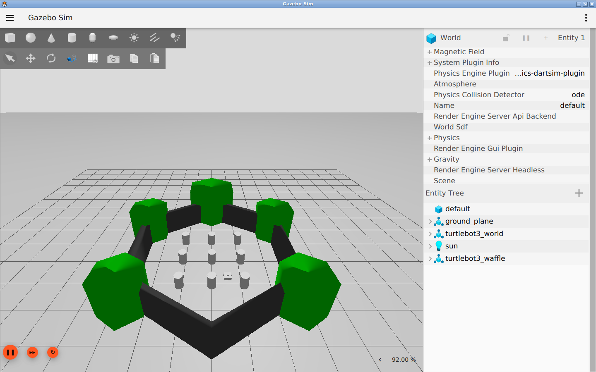

# Nav2 仿真导航实验

本仓库保存 Nav2 基础仿真导航实验的报告、截图、运行脚本和原始验收记录。
实验于 **2026-10-29** 在 Apple Silicon Mac 上完成，采用 Ubuntu ARM64 容器、
ROS 2 Jazzy、Gazebo Harmonic 和 TurtleBot3，实现已知地图中的定位与目标点导航。

## 实验报告

[阅读完整实验报告](doc/nav2_macos_first_run_zh.md)

报告包含项目功能分类、基本原理、环境与依赖安装、仿真启动、自动验收、
故障排查、运行结果及实验局限。

## 实验结果

| 项目 | 双 GUI 实验结果 |
| --- | --- |
| 起点 / 目标 | `(-2.0,-0.5)` / `(-0.5,-0.5)`，单位 m |
| 导航任务状态 | `SUCCEEDED` |
| 最终位置误差 | `0.19827 m`，小于 `0.25 m` 阈值 |
| 最终朝向误差 | `0.06850 rad`，小于 `0.25 rad` 阈值 |
| 里程计净位移 | `1.32318 m` |
| 规划路径 | 58 个 pose |
| 导航耗时 | 约 4.60 秒墙钟，不包含启动和停稳等待 |
| 自动验收退出码 | 0 |

实验运行的是 **Jazzy 发行版二进制**，未编译当前 Nav2 `main`。
验证范围为已知地图中的短距离导航，不包含 SLAM、动态避障专项或实体机器人安全测试。
软件渲染环境中出现的 RViz GLSL 兼容性错误已在报告中保留说明。

### RViz 导航结果



### Gazebo 仿真世界



## 材料目录

| 路径 | 内容 |
| --- | --- |
| [实验报告](doc/nav2_macos_first_run_zh.md) | 完整实验过程及分析 |
| [运行环境](tools/nav2_mac_demo/) | Dockerfile、启动脚本与自动验收脚本 |
| [双 GUI 验收结果](evidence/nav2-gui-result.json) | Gazebo GUI 与 RViz 同时运行时的成功结果 |
| [双 GUI 验收日志](evidence/nav2-gui-smoke.log) | 对应客户端运行日志 |
| [无 Gazebo GUI 验收结果](evidence/nav2-headless-result.json) | Gazebo server 与 RViz 运行时的成功结果 |
| [无 Gazebo GUI 验收日志](evidence/nav2-headless-smoke.log) | 对应客户端运行日志 |
| [首次失败记录](evidence/nav2-first-attempt.log) | 立即读取 TF 导致验收超差的原始日志，保留失败经过 |

## 复现步骤

前提：Apple Silicon Mac 已安装并启动 Docker Desktop。以下命令在本仓库根目录执行。
容器名 `nav2-first-demo` 如已存在，应使用报告中的重启步骤，不应重复创建。

```bash
docker build --platform linux/arm64 -t nav2-first-demo:jazzy tools/nav2_mac_demo
docker run -d --name nav2-first-demo --platform linux/arm64 \
  --shm-size=512m -p 127.0.0.1:6080:6080 nav2-first-demo:jazzy

curl --retry 20 --retry-all-errors --retry-delay 2 \
  -f http://127.0.0.1:6080/vnc.html -o /dev/null
```

图形服务就绪后，在本机浏览器访问
<http://127.0.0.1:6080/vnc.html?autoconnect=1&resize=scale>。
该地址仅用于复现时访问自己的本地容器，不是公网在线演示。

自动设置初始位姿并执行导航：

```bash
docker exec nav2-first-demo bash -lc \
  'source /opt/ros/jazzy/setup.bash
   export ROS_DOMAIN_ID=42 ROS_AUTOMATIC_DISCOVERY_RANGE=LOCALHOST
   timeout --signal=INT --kill-after=10s 240s \
     python3 /opt/smoke_test.py > /tmp/nav2-demo/smoke.log 2>&1
   result=$?
   cat /tmp/nav2-demo/smoke.log
   exit "$result"'

docker exec nav2-first-demo cat /tmp/nav2-demo/result.json
```

验收要求任务成功、传感器数据有效、存在实际运动，且停稳后的位姿误差在设定阈值内。
重复默认起点实验前，应先执行 `docker restart nav2-first-demo` 复位仿真世界。
本仓库提供镜像构建文件，不上传已安装的 Docker 镜像或完整 Nav2 源码。

## 上游项目

实验的源码结构分析对象为
[ros-navigation/navigation2](https://github.com/ros-navigation/navigation2)
的 `b798842e` 提交；运行依赖来自 ROS 2 Jazzy 软件包仓库。
