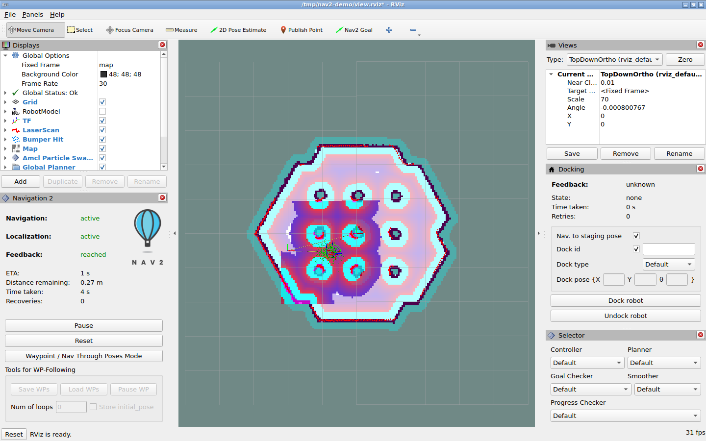
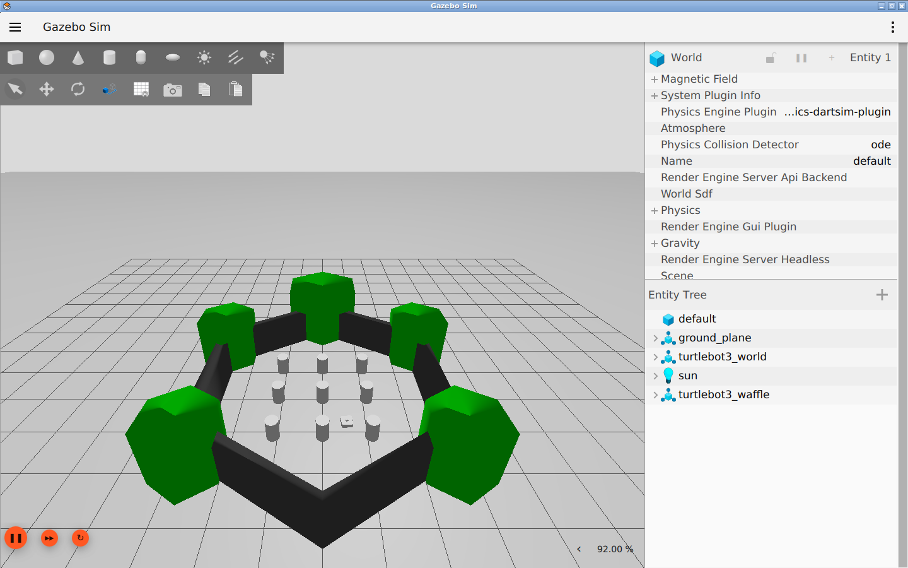

# Nav2 仿真导航实验报告

> 实验日期：2026-10-29。
> 实验平台：Apple Silicon Mac、Docker Desktop、ROS 2 Jazzy、Gazebo Harmonic。
> 实验对象：TurtleBot3 在已知地图中的自主导航。

## 1. 实验目的与项目结构

本实验按照“项目结构分析、环境安装、仿真启动、导航验证、结果分析”的顺序，
完成 Nav2 的基础实践。实验目标如下：

1. 了解 Nav2 各功能包的职责及其协作关系。
2. 在 macOS 主机上建立隔离的 ROS 2、Gazebo 和 RViz 运行环境。
3. 完成已知地图中的单机器人定位、路径规划和目标点导航。
4. 通过任务状态、传感器数据、里程计和最终位姿验证导航结果。

Nav2 是 ROS 2 生态中的移动机器人导航系统，不是 ROS 2 本身，也不是仿真器。
本实验不涉及实体机器人、SLAM 建图、多机器人协同和充电桩对接。

源码分析对象为
[`ros-navigation/navigation2`](https://github.com/ros-navigation/navigation2)
的 `b798842e` 提交。下表描述的是上游 Nav2 源码目录；实验材料仓库仅保存
报告、截图、运行脚本和结果记录，不包含完整 Nav2 源码。
初步分析以根目录、README、启动入口和配置为主，暂不展开算法实现细节。

### 功能分类

| 层次 | 目录 | 主要职责 |
| --- | --- | --- |
| 启动与演示 | `nav2_bringup` | launch、地图、参数、RViz 配置所在；第一个运行入口 |
| 上层任务 | `nav2_bt_navigator`、`nav2_behavior_tree` | 接收导航任务，用行为树组织规划、跟踪和恢复 |
| 路径规划 | `nav2_planner` | 管理全局规划插件；不是直接控制电机 |
| 规划算法 | `nav2_navfn_planner`、`nav2_smac_planner`、`nav2_theta_star_planner` | 全局规划接口的不同算法实现 |
| 路径跟踪 | `nav2_controller` | 管理控制插件，根据路径和机器人状态产生速度指令 |
| 控制算法 | `nav2_dwb_controller`、`nav2_mppi_controller`、`nav2_regulated_pure_pursuit_controller`、`nav2_graceful_controller` | 不同的轨迹跟踪方法 |
| 环境表示 | `nav2_costmap_2d`、`nav2_voxel_grid` | 将静态地图、传感器障碍和安全距离变成导航代价 |
| 地图与定位 | `nav2_map_server`、`nav2_amcl` | 前者提供地图，后者估计机器人在已有地图中的位置 |
| 路径后处理 | `nav2_smoother`、`nav2_constrained_smoother` | 平滑路径；区别于平滑速度 |
| 行为与速度链 | `nav2_behaviors`、`nav2_velocity_smoother`、`nav2_collision_monitor`、`nav2_rotation_shim_controller` | 恢复行为、速度平滑、碰撞监控和旋转衔接 |
| 生命周期 | `nav2_lifecycle_manager` | 有顺序地 configure / activate，不是进程存在就代表服务可用 |
| 面向应用的入口 | `nav2_simple_commander`、`nav2_waypoint_follower` | Python 下发目标、检查任务结果、执行途经点任务 |
| 扩展能力 | `nav2_route`、`nav2_docking`、`nav2_following` | 路网、对接和跟随；不是首个 demo 的前置条件 |
| 公共契约 | `nav2_core`、`nav2_msgs`、`nav2_common`、`nav2_util`、`nav2_ros_common` | 插件接口、消息、构建和 ROS 公共设施 |
| 轻量仿真 | `nav2_loopback_sim` | 根据速度积分生成里程计，不提供完整物理仿真 |
| 集成验证 | `nav2_system_tests` | 理解项目如何判断系统行为正确的后续入口 |
| 开发辅助 | `tools`、`.devcontainer`、`.github`、`Dockerfile` | 开发和 CI 工具；根 Dockerfile 并非本次最小入门环境 |

`navigation2` 是聚合安装依赖的元包。系统通过 launch 启动多个 ROS 节点，
并通过 topic、service 和 action 协作，而非由单一入口依次调用全部功能。

## 2. 实验原理

| 概念 | 含义 |
| --- | --- |
| ROS 2 package | 带 `package.xml` 的构建、安装、依赖管理单元 |
| node | 有 ROS 通信接口的运行单元；不一定一个 node 对应一个操作系统进程 |
| topic | 异步发布/订阅的数据流，例如激光、里程计、速度 |
| service | 请求/响应接口，例如查询生命周期、清理代价地图 |
| action | 可持续较久、有反馈、结果、取消能力的任务，例如 NavigateToPose |
| launch | 启动编排和参数装配；不是导航算法 |
| pluginlib | 运行时加载的接口实现，类似 C++ 动态插件系统 |
| ament / colcon / rosdep | 包构建约定 / 工作空间构建编排 / 系统依赖解析 |
| URDF / SDF | 机器人结构描述 / 仿真世界和模型描述 |
| RViz | ROS 数据可视化工具，不负责物理模拟 |
| Gazebo | 模拟机器人运动、传感器和世界的仿真器 |
| AMCL / SLAM | 在已有地图里定位 / 一边定位一边建图；本实验使用前者 |

导航系统的数据闭环如下：

```text
导航目标（map 中的位置和朝向）
    -> BT Navigator
    -> Planner + 全局 costmap -> 全局路径
    -> Controller + 局部 costmap -> cmd_vel
    -> Gazebo 中的机器人 -> odom、激光 scan
    -> AMCL + TF -> 下一轮规划和控制使用的机器人位姿
    -> Action 返回最终结果
```

主要坐标系包括：`map` 为全局地图，`odom` 为连续但可能累计漂移的里程计坐标系，
`base_footprint` / `base_link` 是机器人本体。常见变换链是
`map -> odom -> base_footprint -> base_link -> sensor`。
AMCL 提供全局定位修正，底盘/仿真提供里程计，robot_state_publisher
根据机器人描述发布关节与传感器的变换。

参与仿真的节点应使用统一时钟：设置 `use_sim_time:=True` 后读取 `/clock`。
仿真暂停时，ROS 时间可能不再前进，因此验收超时采用墙钟时间。

## 3. 实验环境与依赖安装

实验环境记录如下：

| 项目 | 实测 |
| --- | --- |
| 主机 | macOS 27.0，Apple Silicon，`arm64` |
| 内存 / CPU | 16 GiB / 10 逻辑 CPU |
| 工作盘空闲 | 开始时约 31 GiB |
| 已有工具 | Docker Desktop、Homebrew、Python 3、uv |
| 主机 ROS 2 | 未发现 `ros2` 可执行文件 |
| Docker 初始状态 | CLI 存在，但 daemon 没启动 |
| Docker 启动后 | Linux `aarch64`，10 CPU，约 7.65 GiB 内存 |
| 初始仓库提交 | `b798842e`，`[MPPI] Fix absolute speed limit for reverse-only configurations` |

环境检查命令，在 **Mac 终端、上游 Nav2 源码仓库根目录** 执行：

```bash
uname -m
sw_vers
sysctl -n hw.memsize hw.logicalcpu
df -h .
command -v docker brew ros2 python3
docker context show
docker info
git log -1 --oneline
```

初次执行 `docker info` 时提示 Docker socket 不存在，原因是 Docker Desktop
尚未启动。执行 `open -a Docker` 后，daemon 恢复正常。
启动 Desktop 会恢复已有的其他容器；本实验未停止、修改或清理无关容器。

### 3.1 运行方案与版本边界

使用 **Mac -> Docker Desktop Linux VM -> Ubuntu 24.04 ARM64 容器 ->
ROS 2 Jazzy -> Nav2 + Gazebo + RViz**。

Ubuntu 的 `apt` 命令在容器内执行；采用 `linux/arm64` 避免跨架构模拟开销。
图形程序使用容器中的虚拟 X 显示器，再经本机 noVNC 浏览器查看。
宿主屏幕关闭不影响虚拟显示器，但主机休眠仍会暂停计算。

本实验验证的是 **Jazzy 发行版二进制 demo**。源码结构分析基于 Nav2 `main`，
实际运行的 Nav2 来自 `/opt/ros/jazzy`，未编译和验证该 `main` 提交。
launch 参数、地图、消息和 Simple Commander API 可能随发行版变化，
运行时应使用配套的发行版文件。

### 3.2 依赖安装过程

先拉取官方 ROS 基础镜像：

```bash
docker pull --platform linux/arm64 ros:jazzy-ros-base
```

本次拉取的 manifest digest：

```text
sha256:8eed0a4669bbf43ee331878a4c39bd8ebddea8e3312a58b4fae8edb14526b617
```

创建只属于本实验的容器；不挂载整个用户目录，不使用 privileged，
只把图形服务映射到回环地址：

```bash
docker run -d --name nav2-first-demo --platform linux/arm64 \
  --shm-size=512m -p 127.0.0.1:6080:6080 \
  ros:jazzy-ros-base sleep infinity
docker exec nav2-first-demo bash -lc 'apt-get update -qq'
docker exec nav2-first-demo bash -lc \
  'DEBIAN_FRONTEND=noninteractive apt-get install -y --no-install-recommends \
  ros-jazzy-navigation2 ros-jazzy-nav2-bringup \
  ros-jazzy-nav2-minimal-tb3-sim ros-jazzy-rviz2 \
  xvfb x11vnc novnc websockify openbox'
```

随后为了自动最大化 RViz，额外安装了一个小工具：

```bash
docker exec nav2-first-demo bash -lc \
  'DEBIAN_FRONTEND=noninteractive apt-get install -y --no-install-recommends wmctrl'
```

容器中的 shell 是 root，因此不需要 `sudo`。ROS 镜像已经配置 ROS apt 源；
如果是空白 Ubuntu，必须先按 ROS 官方 Ubuntu deb 安装文档配置源和签名，
不能假设这些包直接存在。

安装前 apt 解析到了 Nav2 `1.3.13`、最小 TB3 仿真包 `1.0.1`、
ROS–Gazebo 集成 `1.0.24`、RViz `14.1.24`。以安装后的 `dpkg-query`
记录为准；apt 仓库会继续更新。

安装的主体输出为：1016 个新包，下载约 543 MB，新增安装占用约 2824 MB。
这不包括 Docker 基础镜像、镜像构建缓存、日志等，所以磁盘实际下降会更多。
因此，磁盘规划应同时考虑下载量、安装占用、镜像层和构建缓存。

## 4. 仿真环境启动与交互操作

初次启动采用 **Gazebo server 无 3D 窗口、RViz 有窗口** 的配置。
物理仿真和激光传感器仍由 Gazebo 运行，仅不启动 Gazebo GUI。
实测 Gazebo 是 `gz sim 8.15.0`，即现代 Gazebo Harmonic 系列，不是
已经停止维护的 Gazebo Classic。

启动过程整理为
[`start_demo.bash`](../tools/nav2_mac_demo/start_demo.bash)，主要步骤如下：

1. `source /opt/ros/jazzy/setup.bash`，设置本实验自己的 ROS domain。
2. 生成只调整观察中心的 RViz 配置，不改导航算法参数。
3. 启动 Xvfb 虚拟显示器 `:99`，1440×900，软件 OpenGL 渲染。
4. 启动 Openbox、仅监听容器回环地址的 x11vnc、noVNC/websockify。
5. 启动官方 `tb3_simulation_launch.py`，监控这些顶层进程；退出时报告错误并清理。
   launch 子节点的错误仍要检查 bringup 日志。

图形链路和 ROS 链路是两回事：

```text
Mac 浏览器 -> 127.0.0.1:6080 -> websockify -> 容器 localhost:5900
                                               -> Xvfb :99 -> RViz / Gazebo GUI

Gazebo <-> ros_gz_bridge <-> ROS 2 topic / TF / action <-> Nav2
```

使用 `LIBGL_ALWAYS_SOFTWARE=1` 避免依赖 Docker Desktop 直通 Apple GPU。
该方案以兼容性为主，性能不等同于原生 Linux GPU 环境。
传感器和物理运动数据仍由 Gazebo 生成。

本实验使用 `ROS_DOMAIN_ID=42` 和
`ROS_AUTOMATIC_DISCOVERY_RANGE=LOCALHOST`。所有 ROS 命令都在**同一个容器**
里运行；不假设 ROS 的 DDS 组播能穿过 Docker Desktop VM 自动到达 Mac。
domain 42 只是本次选的隔离编号，不是 Nav2 的强制要求。

手动准备容器那一轮这样启动：

```bash
# 以下仍在 Mac、仓库根目录执行。
docker cp tools/nav2_mac_demo/start_demo.bash nav2-first-demo:/opt/start_demo.bash
docker exec -d -e HEADLESS=True nav2-first-demo bash /opt/start_demo.bash
curl -f http://127.0.0.1:6080/vnc.html -o /dev/null
```

浏览器打开：

<http://127.0.0.1:6080/vnc.html?autoconnect=1&resize=scale>

HTTP 初次探测出现 `Empty reply from server`，稍后返回 200，说明端口映射建立
早于 websockify 完成初始化。通过日志和重试确认服务就绪。
日志位于 `/tmp/nav2-demo/`：

```bash
docker exec nav2-first-demo tail -n 80 /tmp/nav2-demo/bringup.log
docker exec nav2-first-demo cat /tmp/nav2-demo/novnc.log
docker exec nav2-first-demo cat /tmp/nav2-demo/vnc.log
```

### 4.1 初始定位与目标设置

启动后 RViz 暂时报 `map -> base_link` 的 TF 不存在，本次原因是尚未向 AMCL 提供
初始位置。仿真知道机器人在哪里，不代表定位算法自动获得了这个真值。

本次默认出生位置由**容器里安装的 Jazzy launch 文件**确认：
`x=-2.0 m, y=-0.5 m, yaw=0 rad`；地图是 `tb3_sandbox.yaml`，
仿真世界是 `tb3_sandbox.sdf.xacro`。地图和世界要配套。

手动交互流程：

1. 在 RViz 中选 **2D Pose Estimate**，在出生点按住并向 +X 方向拖动，
   告诉 AMCL 近似初始位置和朝向。等待粒子云、机器人 TF 和代价地图出现。
2. 看 Navigation 和 Localization 是否 active，不只看地图图片有没有显示。
3. 选 **Nav2 Goal**，在可通行的空地按住并拖动，设定目标位置和最终朝向。
4. 观察路径、机器人位置和 Feedback；最终应显示 reached。

**2D Pose Estimate 不会将 Gazebo 机器人瞬移。** 该操作更新的是定位器的
初始位姿估计。若机器人已经移动，仅重设定位并不等于复位仿真世界。
重复默认起点实验前，应重启实验容器，使 Gazebo 世界与定位状态一致。

RViz 的 `Move Camera` 和滚轮可以平移、缩放视图。脚本额外将默认视图的
观察中心移到 `(0,0)`，防止首次窗口里地图偏在一侧；没有修改地图或障碍物。
右侧 Docking 面板未配置充电桩，与这个 demo 无关。

## 5. 自动验收方法与实验结果

为消除人工点击差异并记录可量化结果，使用 Jazzy 验收客户端
[`smoke_test.py`](../tools/nav2_mac_demo/smoke_test.py)。
该客户端通过发行版提供的 `BasicNavigator` 调用 Nav2，不替代导航算法。

验收动作：

1. 订阅 `/clock`、`/scan`、`/odom`，等待时间推进和有效激光测量。
2. 设置 `(-2.0,-0.5,0)` 初始位姿，等待 AMCL 以及 Nav2 激活。
3. 通过 `ComputePathToPose` action 预检查能否生成非空路径。
4. 发送 `NavigateToPose` 目标 `(-0.5,-0.5,0)`。
5. 观察实际非零 `/cmd_vel`、非空 `/plan` 和仿真里程计位移。
6. 要求 Action 为 `SUCCEEDED`；等待车体停稳，再读取 `map -> base_link`。
7. 要求最终位置误差不超过 **0.25 m**、朝向误差不超过 **0.25 rad**，
   里程计净位移至少 **0.5 m**，与 Action 状态共同作为通过条件。

脚本内导航阶段最多等待 120 秒墙钟，外层 `timeout` 将初始化和服务等待
也限制在 240 秒，超时发送中断并尝试取消任务。即使仿真时钟卡住，也不会
因为用 ROS 时间做超时而永远挂住。

在 **Mac、仓库根目录**：

```bash
docker cp tools/nav2_mac_demo/smoke_test.py nav2-first-demo:/opt/smoke_test.py
docker exec nav2-first-demo bash -lc \
  'source /opt/ros/jazzy/setup.bash
   export ROS_DOMAIN_ID=42 ROS_AUTOMATIC_DISCOVERY_RANGE=LOCALHOST
   timeout --signal=INT --kill-after=10s 240s \
     python3 /opt/smoke_test.py > /tmp/nav2-demo/smoke.log 2>&1
   result=$?
   cat /tmp/nav2-demo/smoke.log
   exit "$result"'
```

命令退出码必须为 0。成功 JSON 在 `/tmp/nav2-demo/result.json`；
每次运行先清理该结果文件，避免上一次成功的 JSON 掩盖本次失败。
脚本成功后**不关闭 Nav2**，可以继续在 RViz 里交互。

### 5.1 首次验收失败及测量方法修正

首次验收中，Action 返回成功，里程计位移约 1.28 m，但客户端立即读取的
TF 位置误差为 **0.25446 m**，超过设定的 0.25 m，验收退出码为 1。

随后使用 `tf2_echo` 观察停稳后的变换，位置约为 `(-0.678,-0.580)`，
误差降至约 0.195 m。任务结果、TF 消息处理和机器人速度归零并非同步事件。
据此调整**测试测量时机**：继续处理 ROS 回调，
至少等一秒，并检查里程计速度已经接近零，再测最终位姿。
没有修改目标容差、控制器或 Action 结果。

重启实验容器，将 Gazebo 和定位都重置后再测。修正测量流程后的无 3D GUI
实验记录如下：

| 指标 | 无 Gazebo 3D GUI 验收结果 |
| --- | --- |
| Action 结果 | `SUCCEEDED` |
| 起点 / 目标 | `(-2.0,-0.5)` / `(-0.5,-0.5)`，米 |
| 最终 map 坐标 | `(-0.66944,-0.57293)`，米 |
| 位置 / 朝向误差 | `0.18447 m` / `0.03368 rad` |
| 里程计净位移 / 累计路程 | `1.33573 m` / `1.33994 m` |
| 预检查规划路径 | 58 个 pose |
| 导航耗时 | 约 4.55 秒墙钟，不包括启动和停稳等待 |
| 收到的 clock / scan / odom | 1908 / 41 / 170 条 |
| 非空 plan / 非零速度 | 6 / 92 条 |
| 脚本退出码 | 0 |

数值会受调度、仿真速度和定位随机性影响，不应逐字匹配 JSON。
可重复的是验收行为和阈值，而不是这一次运行的浮点数。

实测 `amcl`、`map_server`、`controller_server`、`planner_server`、
`bt_navigator`、`collision_monitor` 均为 `active [3]`。
日志出现 `controller_server: Reached the goal!` 和
`bt_navigator: Goal succeeded`。

这里证明的是已知地图中的一次短距离导航、定位和仿真反馈闭环，不等于已经
验证复杂动态避障、SLAM、所有插件、实体底盘安全或当前 main 源码的回归测试。

### 5.2 结果判定范围

本实验通过传感器、定位、规划、控制和任务结果的联合观测判断导航闭环，
不以安装完成或窗口显示作为最终通过条件。

## 6. 实验环境复现与双 GUI 验证

依赖清单、启动脚本和验收脚本位于
[`tools/nav2_mac_demo/`](../tools/nav2_mac_demo/)。
Dockerfile 固定了本次 ROS 基础镜像 digest；apt 依赖仓库仍会随时间更新，
因此它不是锁定全部 deb 包的逐位可重现构建。

### 6.1 镜像构建与启动

以下在 **Mac、仓库根目录**，已安装并启动 Docker Desktop 的前提下执行：

```bash
docker build --platform linux/arm64 -t nav2-first-demo:jazzy tools/nav2_mac_demo
docker run -d --name nav2-first-demo --platform linux/arm64 \
  --shm-size=512m -p 127.0.0.1:6080:6080 nav2-first-demo:jazzy
```

**如果已有同名容器，应使用重启命令，而非再次执行 `docker run --name nav2-first-demo`。**
实验最终使用的是由此镜像启动的容器；使用下面的重启方式。
镜像版把启动脚本作为默认命令，因此不再需要额外 `docker exec -d` 启动。

最终脚本默认 `HEADLESS=False`：启动 Gazebo 3D GUI 和 RViz，二者都可以在
同一个 noVNC 桌面查看。最开始验证闭环时用的是 `HEADLESS=True`；
低资源电脑也可以在创建容器时添加 `-e HEADLESS=True`，保留 RViz，
不启动 Gazebo 的 3D 窗口。物理仿真仍然运行。

### 6.2 全新容器中的双 GUI 验收

完成镜像构建并保存先前日志后，停止并删除本实验的手工安装容器，
由新镜像创建同名容器。在全新容器内启动 Gazebo GUI 和 RViz，
再次从默认出生点运行验收，结果如下。

| 指标 | 最终镜像实测 |
| --- | --- |
| 本机镜像名 | `nav2-first-demo:jazzy` |
| 镜像架构 | `arm64` |
| 镜像 ID | `sha256:29f4964fe1ddd0b71ed5c6d7ebdc592e39b6f3a64b16f2de1892326b3f00f8bf` |
| 默认启动命令 | `bash /opt/start_demo.bash` |
| 真实窗口 | `Gazebo Sim`、`RViz`，均在 Xvfb 桌面 |
| Action / 验收退出码 | `SUCCEEDED` / 0 |
| 最终 map 坐标 | `(-0.69032,-0.55558)`，米 |
| 位置 / 朝向误差 | `0.19827 m` / `0.06850 rad` |
| 里程计净位移 / 累计路程 | `1.32318 m` / `1.32705 m` |
| 规划路径 / 导航墙钟耗时 | 58 个 pose / 约 4.60 秒 |
| clock / scan / odom 消息 | 1833 / 37 / 162 条 |
| 非空 plan / 非零速度消息 | 6 / 93 条 |

实验截图：





用 Alt-Tab 可以在两个窗口之间切换。Gazebo 左下角的暂停会停止仿真时间，
排障时应区分仿真暂停和 ROS 节点异常。

这条软件渲染路线也并非完全无日志问题：双 GUI 启动时 RViz 曾打印一次
`GLSL link result: active samplers with a different type refer to the same texture image unit`。
实际窗口随后显示了代价地图，导航和独立运动验收通过。
实验未修改 RViz/Ogre 源码，也未验证所有显示模式，故将该信息保留为
尚未解决的图形兼容性问题。

资源只是当时快照：无 Gazebo GUI 时约 723 MiB、190% CPU；
双 GUI 时约 1.29 GiB、624% CPU。Docker 百分比里一个满载逻辑核约为 100%，
不能把 624% 理解为“占整机六倍”。这不是性能基准，两个时刻负载也并非严格相同。
最终主机工作盘约剩 18 GiB；实际使用还应留意 Docker 镜像层和构建缓存。

### 6.3 停止与重启

```bash
# 已有本次镜像版容器：重启就会自动重新启动整个 demo，世界回到初始状态。
docker restart nav2-first-demo

# 等图形服务就绪，初始化并运行前面的验收命令。
curl --retry 20 --retry-all-errors --retry-delay 2 \
  -f http://127.0.0.1:6080/vnc.html -o /dev/null

# 查看日志、结果和运行状态。
docker exec nav2-first-demo tail -n 60 /tmp/nav2-demo/bringup.log
docker exec nav2-first-demo cat /tmp/nav2-demo/result.json
docker stats --no-stream nav2-first-demo

# 不用时停止，只操作本实验自己的容器。
docker stop nav2-first-demo

# 再次打开。
docker start nav2-first-demo
```

注意：容器重启后文件系统里的历史 `result.json` 不等于“这次已经导航成功”。
要重新执行验收脚本，它会删除旧结果后再测试。
机器人移动后不应直接用默认初始坐标重复初始化；应先复位世界，
或明确传入与实际位置一致的 `--initial-x/--initial-y` 和新目标。

noVNC 本实验没有设置密码，因为 Docker 端口仅映射到主机
`127.0.0.1`，x11vnc 也只监听容器回环地址。不应改成 `0.0.0.0` 暴露给局域网；
共享主机上的其他本地用户仍可能访问它，这不是多人服务器的安全部署方案。

安装好的容器和镜像都保留在本机，Nav2 源码没有挂载进去，demo 不会改动
checkout。整个过程中没有清理 Docker 其他容器、镜像或卷。
本次安装时为避免熄屏后空闲休眠，临时使用了 `caffeinate -i`；
它只防空闲系统休眠，不阻止用户主动睡眠或合盖。

## 7. 运行系统分析与故障排查

通过 ROS graph 和运行时参数，确认本次实验配置如下：

| 运行时对象 | 本次用途 |
| --- | --- |
| `/map_server` | 发布已有的 sandbox 占据栅格地图 |
| `/amcl` | 用激光、里程计和地图估计全局位姿 |
| `/planner_server` 的 `GridBased` | `nav2_navfn_planner::NavfnPlanner` |
| `/controller_server` 的 `FollowPath` | `nav2_mppi_controller::MPPIController` |
| `/bt_navigator` | 提供 `/navigate_to_pose`，组织规划和路径跟随 |
| costmap | 本次包含静态、激光障碍/体素、膨胀等层，由配置决定 |
| `/velocity_smoother`、`/collision_monitor` | 位于控制输出到最终底盘速度之间 |
| `/ros_gz_bridge` | 桥接 ROS 消息与 Gazebo Transport，不是全局规划器 |
| `/robot_state_publisher` | 根据机器人描述提供本体到各 link 的 TF |
| lifecycle managers | 管理定位和导航节点激活顺序 |

系统运行状态需要结合多个模块判断：插件加载成功不等于仿真正常运行，
节点 active 不等于持续收到有效传感器数据，规划成功也不等于机器人能够完成跟踪。

本次观察到的接口：

| 接口 | 类型 | 用来回答的问题 |
| --- | --- | --- |
| `/clock` | `rosgraph_msgs/msg/Clock` | 仿真是否真正前进？ |
| `/scan` | `sensor_msgs/msg/LaserScan` | 激光数据是否有效、持续更新？ |
| `/odom` | `nav_msgs/msg/Odometry` | 仿真机器人是否实际移动？ |
| `/amcl_pose` | `geometry_msgs/msg/PoseWithCovarianceStamped` | 定位是否建立？ |
| `/map` | `nav_msgs/msg/OccupancyGrid` | 机器人使用的是哪张地图？ |
| `/tf` | `tf2_msgs/msg/TFMessage` | 不同坐标系的观测能否互相转换？ |
| `/plan` | `nav_msgs/msg/Path` | 全局规划器是否在输出路径？ |
| `/cmd_vel` | `geometry_msgs/msg/Twist` | 最终发送给底盘/仿真的速度是否非零？ |
| `/navigate_to_pose` | `nav2_msgs/action/NavigateToPose` | 任务接受、反馈、取消和结果 |

以上类型来自本次 Jazzy 安装，其他 ROS 发行版可能不同。
例如 main 文档里的 stamped cmd_vel、Simple Commander task handle
API 就可能与发行版有差别。

### 7.1 诊断命令

先进入容器，再设置与启动脚本相同的 domain：

```bash
docker exec -it nav2-first-demo bash
source /opt/ros/jazzy/setup.bash
export ROS_DOMAIN_ID=42 ROS_AUTOMATIC_DISCOVERY_RANGE=LOCALHOST

ros2 node list
ros2 node list --no-daemon
ros2 topic list -t
ros2 action list -t
ros2 lifecycle get /amcl
ros2 lifecycle get /bt_navigator
ros2 param get /planner_server GridBased.plugin
ros2 param get /controller_server FollowPath.plugin
ros2 param get /controller_server general_goal_checker.xy_goal_tolerance
ros2 param get /controller_server general_goal_checker.yaw_goal_tolerance
ros2 topic echo /clock --once
ros2 topic echo /odom --once
ros2 topic hz /scan
ros2 run tf2_ros tf2_echo map base_link
```

最后两个命令持续运行，按 Ctrl-C 结束。命令刚启动时 DDS 发现和 TF 缓存
尚未建立，`tf2_echo` 先报一次 frame 不存在不等于系统永远没有这个 frame；
要看后续是否持续输出有效变换。
最终容器中新 CLI 首次查询 lifecycle 时曾显示 `Node not found`；
通过 `ros2 node list --no-daemon` 重新发现图后，再查询为 `active [3]`，
后台进程和仿真始终在运行，表明单次 graph 查询不足以判定节点崩溃。

排障次序应是：**进程/日志 -> 仿真时钟 -> 数据 topic -> TF -> 生命周期 ->
规划路径 -> 控制速度 -> Action 结果**。直接改代价地图参数通常太早。

| 现象 | 判断与处理 |
| --- | --- |
| Mac 上没有 apt / ros2 | 区分宿主和容器，ROS 命令放进容器 |
| Docker socket 不存在 | 启动 Docker Desktop，再验证 daemon |
| README 的文档链接 404 | 从文档主页选 Jazzy 版本，不编造旧页面内容 |
| Gazebo 启动前短暂没有 odom TF | 等机器人生成和 bridge 就绪，再看是否持续失败 |
| global costmap 等 map TF | 先给 AMCL 正确初始位姿 |
| SDF 的 `gz_frame_id` warning | 本次后续仍产生有效 scan、odom，不据此判断启动失败 |
| Docking 没有 dock database warning | 未测试对接，不影响此次 NavigateToPose |
| RViz 丢弃早期旧时间戳消息 | 检查后续时间和 TF；本次是初始化阶段的旧消息 |
| 不同终端看不到 node | 先检查是否 source、domain 一致、在同一个容器内 |
| Action 成功但立刻测量略超容差 | 等停稳并处理新 TF，再测；不能直接放宽阈值 |
| 第二次默认测试定位不对 | 初始位姿消息不是物理复位；先重启仿真世界 |

## 8. 实验总结与后续工作

本实验完成了项目结构梳理、依赖安装、仿真环境启动以及两种图形配置下的
目标点导航验收。最终双 GUI 实验中，位置误差为 **0.19827 m**，
朝向误差为 **0.06850 rad**，均小于配置的 **0.25 m / 0.25 rad** 阈值。
里程计净位移为 **1.32318 m**，导航 Action 返回 `SUCCEEDED`。

后续源码学习和实验计划如下：

1. 先看 `nav2_bringup/launch` 和 `params`，把实际 node、插件和通信关系画出来。
2. 看 `nav2_msgs/action/NavigateToPose.action` 和 `nav2_core` 的插件接口，
   明确 C++ 模块的输入输出和生命周期。
3. 从本次确实使用的 Navfn 或 MPPI 选择一个，沿 server 到插件的调用链阅读。
4. 再研究 costmap 如何消费地图、激光和 TF，以及机器人 footprint 和 inflation
   怎样影响可通行区域。
5. 最后再看行为树恢复逻辑、系统测试、SLAM 和实体机器人接入。

当前 main 的 CI 文件 `.github/workflows/build_main_against_distros.yml`
确实覆盖 Jazzy 和 Lyrical 的源码兼容性构建，但明确跳过了一部分 bringup/demo
包，因此核心代码兼容性构建不能替代完整 demo 的运行验证。

**本实验未编译当前 main，也未验证所有算法与插件。** 下一阶段修改源码时，
应在独立 Linux ROS 工作空间中选择匹配分支/underlay，按
`rosdep -> colcon build -> source overlay -> 针对修改的测试 -> 仿真回归`
推进，并避免混用 main 启动文件、Jazzy 参数与其他发行版的二进制。

`nav2_loopback_sim` 适合以后做高层应用的快速开发和系统测试；它免去了完整
物理引擎和真实定位误差，但不能拿它替代这次 Gazebo + 激光 + AMCL 的验收，
其结果也不能用于推断实体机器人安全性。

实验验证了以下完整链路：**目标 -> 导航决策 -> 速度 -> 机器人运动 ->
传感器和定位 -> 任务结果**。后续可在此基础上开展复杂路径、动态障碍、
SLAM 和实体平台实验。

## 9. 参考资料

实验期间，上游 README 中旧的 `https://docs.nav2.org/getting_started/index.html`
返回 404。文档主页已采用带发行版的路径，本实验参考 Jazzy 版本：

- [Nav2 Jazzy 文档](https://docs.nav2.org/jazzy/)
- [Jazzy Quickstart](https://docs.nav2.org/jazzy/getting_started/quickstart/quickstart/)
- [ROS 2 Jazzy Ubuntu deb 安装](https://docs.ros.org/en/jazzy/Installation/Ubuntu-Install-Debs.html)
- [ROS 2 入门教程](https://docs.ros.org/en/jazzy/Tutorials.html)
- 仓库：`nav2_bringup/README.md`、`nav2_loopback_sim/README.md`、
  `nav2_simple_commander/README.md`

后续阅读顺序为：启动参数、topic / TF / action、配置文件、插件接口，
再进一步分析具体算法实现。
