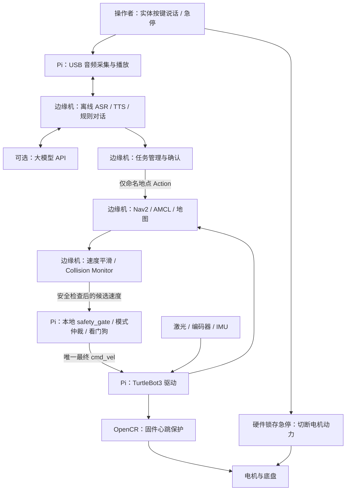

# 第二阶段：Nav2 语音导航小车实体实践设计

设计日期：2026-11-04。类型：**实施设计与实验任务书，不是已完成实验报告**。

目标是做出一台能够在室内已知地图中规划路径、到达命名地点、进行中文语音交互，
并在后期接入大模型 API 的差速小车。采用成熟 ROS 2 成套平台，优先降低装配、
驱动和接口适配风险。

**当前仅完成设计与上游资料核实；尚未采购、接线或完成实体测试。**
所有速度、误差、时延和成功率都是验收要求，不是已测结果。第一阶段 Mac 仿真
结果不能替代实体车验收。阅读者应依次完成下面五个 Phase，并记录真实证据。

## 与代码阶段任务的边界

本目录只存放实体实践方案、采购条件和验收要求，不修改第一阶段
`tools/nav2_mac_demo/`，不把硬件 Phase 当成软件开发任务编号。

| 命名空间 | 含义 | 记录规则 |
| --- | --- | --- |
| `HW-P1`～`HW-P5` | 本设计的五个实体实践阶段 | 仅根据装配、实测和证据验收，不因代码合并自动通过 |
| `SW-*` | 后续软件实现任务 | 单独建任务；实现接口、测试和部署，不与 HW 编号混用 |
| `HW-Pn-RUN-*` | 实体试验记录 | 实测后新建，记录硬件/固件/配置版本和失败情况 |

截至设计日，仓库仅有第一阶段报告、脚本与证据，未发现其他代码阶段目录。
本次不创建软件包、不开启代码任务、不采购设备，也不将计划中的命令描述为现有功能。
后续自研代码建议放在 `robot-software/`，实体记录放在
`hardware-practice/runs/`；这两个目录**尚未创建**。

## 五个阶段

| Phase | 任务书 | 完成条件 | 预计有效工时，不含物流 |
| --- | --- | --- | --- |
| HW-P1 | [硬件选型、采购与装配](phase-01-hardware.md) | 型号与供电确定，急停方案落地，设备枚举与机械检查通过 | 2～4 天 |
| HW-P2 | [驱动、通信与本地安全控制](phase-02-base-and-safety.md) | 架空测试、里程计、单一速度出口和故障停车通过 | 3～6 天 |
| HW-P3 | [真实建图与 Nav2 导航](phase-03-mapping-and-navigation.md) | 自己场地的地图、定位、命名目标与实体路线验收通过 | 4～7 天 |
| HW-P4 | [中文离线语音与任务对话](phase-04-voice.md) | 车上录音/播报、离线识别、规则对话和确认后导航通过 | 4～7 天 |
| HW-P5 | [大模型 API 与整机交付](phase-05-llm-and-delivery.md) | 工具白名单、异常处理、断网降级和他人复现通过 | 4～7 天 |

建议预留 4～8 周日历时间。P1 不通过不落地运动；P2 不通过不自动导航；
P3 不通过不允许语音驱动车辆；P4 不通过不添加大模型运动工具。

## 固定主方案

| 项目 | 主方案 |
| --- | --- |
| 底盘 | ROBOTIS TurtleBot3 **Burger** 完整套装，Pi 4 + OpenCR + 双编码器电机 |
| 激光 | 主方案明确购买 **LDS-02**；其他雷达需重新核对驱动与端口 |
| 车载计算 | 原套装 Raspberry Pi 4，Ubuntu Server 24.04 ARM64 + ROS 2 Jazzy |
| 边缘计算 | 独立 x86_64 小主机，Ubuntu Desktop 24.04 + ROS 2 Jazzy；放在桌面，不装到车上 |
| Mac | SSH、文档和现有仿真；不承担实体车的 DDS/Nav2 主运行环境 |
| 导航 | slam_toolbox 建图，地图服务器 + AMCL 定位，Navfn 全局规划 + DWB 跟踪 |
| 语音 | 车上 USB 全双工音频设备，按键说话；边缘机 sherpa-onnx 离线中文 ASR/TTS |
| 大模型 | 第五阶段通过边缘机 HTTP API 接入，不在 Pi 上训练或运行大参数模型 |
| 场地 | 单层室内平整地面，专用局域网，受控人员活动，无楼梯、道路和电梯 |

**这是“车载驱动 + 局域网边缘计算”的移动机器人，不是脱离服务器的全车载产品。**
切断公网后仍应能离线导航、固定语音指令和播报；切断车与边缘机之间的局域网，
必须本地停车。未来全车载化需另做算力、散热、电源和负载测试，不在五阶段主线中。

与第一阶段保持 Jazzy 发行版一致，但不能复用仿真机器人的 URDF、地图和速度接口：
官方实体 TurtleBot3 Jazzy 的最终 `/cmd_vel` 是 **`geometry_msgs/msg/TwistStamped`**。
不要把第一阶段 `smoke_test.py` 原样用于实体车。

## 系统架构

LLM 不能访问电机、发布速度、执行 shell 或修改地图。语音“停止”是交互取消，
**不等同于硬件急停，也不是功能安全保护**。任何自动恢复都不得重新启动车辆。

## 实现与复现约定

各 Phase 中分两类内容：

- **上游现有命令**：已核对手册或源码，可在匹配环境安装后执行，仍需现场验证。
- **待实现接口/启动契约**：任务管理、安全网关、音频网关等不是本仓库现成程序；
  文档给出输入输出、处理规则与验收案例，后续作为独立 `SW-*` 任务实现。

实体执行前必须完成该 Phase 要求的待实现接口。不应为了先看到车动而绕开安全网关。
本次没有在没有硬件的情况下执行刷机、驱动启动或自动运动命令。

所有终端使用同一 `ROS_DOMAIN_ID=42`，机器人和边缘机使用局域网发现，
`use_sim_time=false`，时钟同步。与第一阶段不同：**实体环境不能使用
`ROS_AUTOMATIC_DISCOVERY_RANGE=LOCALHOST`**。详细步骤见 P2。

## 统一验收记录

每次实测应记录：日期、操作者编号、场地、设备型号、固件及 Git SHA、deb 版本、
配置哈希、电池起止电压/电量、网络条件、测试输入、预期结果、实际结果、失败原因。
拍摄的视频应同时覆盖机器人和操作过程；bag/日志时间要能与视频对应。

通过结果可以公开上传；Wi-Fi 密码、SSH 私钥、API key、未经同意的声音和影像
不得提交。大 bag、模型和视频不直接塞进 Git 历史，应使用 Git LFS 或 Release，
并记录下载地址、大小和 SHA256。不可达目标和故障测试也必须保留。

最终演示：按键说“去实验台”→小车复述地点→操作者确认→显示规划路径并行驶→
到达后播报；随后查询电量、取消任务；断公网保持离线能力，断局域网安全停车。

## 参考依据

[参考项目、固定版本与兼容性记录](references.md)列出本次实际核对的 GitHub 项目，
说明借鉴内容、许可证和不能照搬的边界。采购总额见 P1；价格是预算，不是供应商报价。
